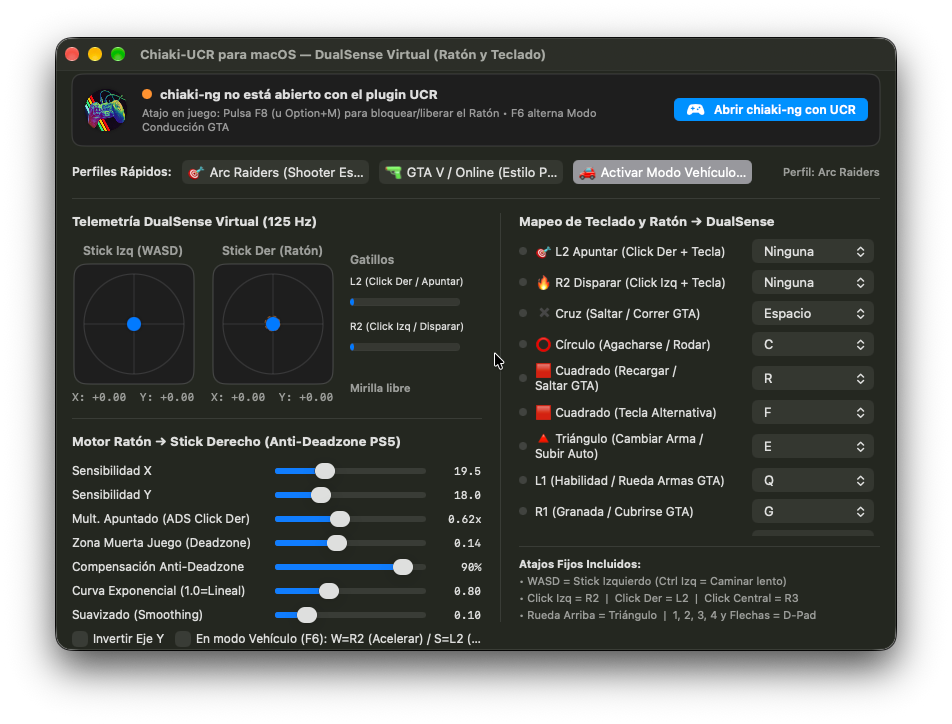

<p align="center">
  
</p>

<h1 align="center">Chiaki-UCR para macOS</h1>

<p align="center">
  <b>Mapeador nativo de Ratón y Teclado a DualSense Virtual de PlayStation para chiaki-ng en Apple Silicon</b>
</p>

<p align="center">
  <a href="https://github.com/ChrystianLozano/ChiakiUCR/releases/latest">
    
  </a>
  
  
  
</p>

---

## 📖 Acerca del Proyecto

**Chiaki-UCR** es un sistema compuesto por un **plugin nativo C++/Objective-C++** inyectado por `DYLD_INSERT_LIBRARIES` y una **aplicación de control en SwiftUI** para macOS. Permite jugar en tu PlayStation (PS5 / PS4) mediante **[chiaki-ng](https://github.com/streetpea/chiaki-ng)** utilizando tu **ratón y teclado** como si fueran un mando **DualSense** real.

A diferencia de soluciones externas lentas o que requieren drivers de kernel pesados, Chiaki-UCR se integra directamente con el subsistema virtual de **SDL2** (`SDL_VirtualJoystickDesc`) a **125 Hz**, logrando latencia imperceptible, emulación precisa del stick analógico derecho y compatibilidad directa con Remote Play.

<p align="center">
  
</p>

---

## ✨ Características Principales

* **🕹️ Emulación DualSense Virtual Nativa (125 Hz):** Chiaki detecta un control PlayStation DualSense real gracias a la API de SDL2, sin emuladores de gamepad externos.
* **🎯 Motor Anti-Deadzone y Curva de Ratón:**
  * Compensación de la zona muerta interna de juegos de PS5 (0 a 100%).
  * Ajuste de sensibilidad independiente para ejes X e Y.
  * Multiplicador ADS para apuntar con precisión (clic derecho).
  * Curvas de respuesta (lineal / exponencial) y suavizado de micro-movimientos.
* **🚗 Modo Vehículo Inteligente (F6):** Conduce en juegos estilo GTA alternando el modo vehículo donde `W` se convierte en acelerador analógico (`R2`) y `S` en freno/reversa (`L2`).
* **⚡ Telemetría y Monitoreo en Tiempo Real:** La app SwiftUI se sincroniza a alta velocidad con el plugin inyectado mediante memoria compartida POSIX (`/tmp/chiaki_ucr_state.shm`).
* **🔒 Captura de Cursor Fluida:** Alterna el bloqueo/liberación del puntero en cualquier momento con `F8` (o `Option + M`).
* **🎨 Perfiles Rápidos:** Cambia entre perfiles optimizados para *Shooters / FPS* y juegos de mundo abierto (*GTA V / Online*).

---

## 📥 Descarga e Instalación Rápida

### 1. Requisitos Previos
* Mac con procesador **Apple Silicon (M1 / M2 / M3 / M4)** con macOS 13 (Ventura) o posterior.
* Tener instalado **[chiaki-ng](https://github.com/streetpea/chiaki-ng/releases)** en tu carpeta de `/Applications/chiaki-ng.app`.

### 2. Descargar la App
1. Ve a la sección de **[Releases](https://github.com/ChrystianLozano/ChiakiUCR/releases/latest)**.
2. Descarga el archivo **`Chiaki-UCR-macOS-arm64.zip`**.
3. Descomprímelo y arrastra **`Chiaki-UCR.app`** a tu carpeta `/Applications`.

### 3. Permitir la Ejecución en macOS (Gatekeeper)
Al ser una aplicación de código abierto descargada de internet sin firma de pago de Apple, macOS puede mostrar el aviso *"La aplicación está dañada y no se puede abrir"* o bloquearla. Para habilitarla de inmediato:

Abre la **Terminal** de tu Mac y ejecuta:

```bash
xattr -cr /Applications/Chiaki-UCR.app
```

> **Nota sobre Permisos:** Cuando abras la app y bloquees el ratón por primera vez, macOS puede solicitar permisos de **Accesibilidad** o **Monitorización de entrada** (*Ajustes del Sistema > Privacidad y Seguridad*). Acéptalos para que el cursor y las teclas se capturen correctamente durante la sesión de juego.

---

## 🎮 Guía de Uso

1. Abre **`Chiaki-UCR.app`**.
2. En la barra superior, haz clic en el botón azul **"Abrir chiaki-ng con UCR"**.
   * Chiaki-ng se abrirá automáticamente con el plugin DualSense inyectado.
3. Inicia la transmisión con tu PS5 o PS4 en chiaki-ng.
4. **Atajos en partida:**
   * **`F8`** (o **`Option + M`**): Bloquea el ratón dentro del juego y activa el control DualSense. Vuelve a presionarlo para liberar el cursor y usar tu Mac normalmente.
   * **`F6`**: Alterna el **Modo Conducción / Vehículo** (W = Acelerar R2 / S = Frenar L2).

### ⌨️ Mapeo de Teclas por Defecto

| Botón DualSense | Tecla / Acción |
| :--- | :--- |
| **Stick Izquierdo (Movimiento)** | `W`, `A`, `S`, `D` (`Ctrl Izq` = Caminar lento) |
| **Stick Derecho (Cámara / Mirilla)** | Movimiento del **Ratón** |
| **L2 (Apuntar)** | **Clic Derecho** |
| **R2 (Disparar)** | **Clic Izquierdo** |
| **Cruz (Saltar / Correr)** | `Espacio` |
| **Círculo (Agacharse / Rodar)** | `C` |
| **Cuadrado (Recargar / Interactuar)** | `R` (Alternativa: `F`) |
| **Triángulo (Cambiar Arma)** | `E` (o Rueda Arriba) |
| **L1 (Habilidad / Rueda de armas)** | `Q` (mantener + mover ratón = selección asistida en la rueda) |
| **R1 (Granada / Cubrirse)** | `G` |
| **L3 (Correr / Sprint stick)** | `Shift Izquierdo` |
| **R3 (Cuerpo a cuerpo / Melee)** | `Clic Central` (Rueda del ratón) |
| **D-Pad (Cruceta)** | Teclas `1`, `2`, `3`, `4` y Flechas |
| **Touchpad Click (Mapa / Inventario)** | `Tab` |
| **Options / Pausa** | `M` / `Enter` |

> **🎡 Asistente de Rueda de Armas:** mientras mantienes `L1`, el ratón mueve un cursor virtual que deja el stick derecho apuntando al elemento elegido (no regresa al centro al detener el ratón). Se activa/desactiva y se ajusta su sensibilidad desde la app.

*Todos los controles y sensibilidades se pueden ajustar en tiempo real desde el panel de control de la app.*

---

## 🛠️ Compilación desde el Código Fuente

Si deseas compilar el proyecto tú mismo:

```bash
# 1. Clonar el repositorio
git clone https://github.com/ChrystianLozano/ChiakiUCR.git
cd ChiakiUCR

# 2. Compilar la aplicación y el plugin dylib
make

# 3. (Opcional) Empaquetar el ZIP de distribución
make release
```

El ejecutable quedará generado en `Chiaki-UCR.app`.

---

## 📄 Licencia

Este proyecto está distribuido bajo la licencia **MIT**. Consulta el archivo [LICENSE](LICENSE) para más información.

---

<p align="center">
  Desarrollado con ❤️ por <a href="https://github.com/ChrystianLozano">Chrystian Lozano</a>
</p>
